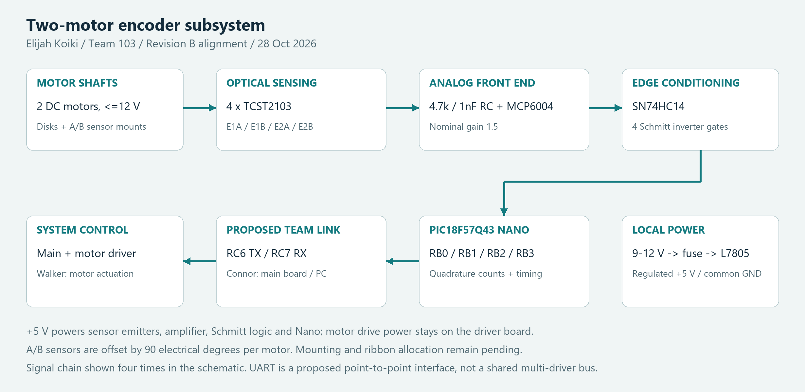

# Individual Block Diagram

The encoder board converts the rotation of two motor shafts into four clean digital signals. This updated diagram includes the **MCP6004 amplification and RC filtering stages** required to keep the architecture consistent with the Revision B schematic.

*Figure 1. Two-motor encoder architecture. The arrows show the feedback path; the local power block supplies the sensing and logic circuits.*

[Editable SVG](encoder-block-diagram.svg){.download} [Diagram source ZIP](encoder-block-diagram-source.zip){.download}

## Signal path and design decisions

| Stage | Function | Design rationale |
| --- | --- | --- |
| Shafts and disks | One patterned disk per motor; two sensors per disk | A/B phase order supplies direction as well as incremental motion. |
| Four TCST2103 sensors | LED and phototransistor channels E1A, E1B, E2A, E2B | Bare optical components expose the analog signal for a custom front end. |
| RC + MCP6004 | 4.7 kΩ pull-up / 1 nF node filtering; nominal non-inverting gain 1.5 | Repeated channels support matched conditioning; gain and bandwidth need bench confirmation. |
| SN74HC14 | Four Schmitt inverter gates | Hysteresis converts slow analog transitions into digital edges. Both A/B channels are inverted, preserving their relative quadrature sequence. |
| PIC18F57Q43 Nano | RB0–RB3 receive A/B signals; proposed interrupt-driven decoding | Counts and timing can provide relative position and speed. |
| Team connection | Proposed RC6 TX / RC7 RX through J6, with TX isolation jumper JP1 | A local serial feedback link reduces the number of signals the main board must process. Final bus allocation is pending. |

The encoder board measures motion; Walker's board supplies motor actuation. Separating these roles allows the team to inspect encoder performance independently of the driver. Connor's main controller is the proposed recipient of the feedback and the connection to the PC.

## Power and interface boundaries

J1 accepts the schematic's **9–12 V center-positive DC input**. F1 and U1 provide a fused input and regulated +5 V for the Nano, sensors and conditioning circuits. The team PRD uses 9 V; 12 V is a schematic allowance that increases heating and requires thermal verification. The ribbon shares ground, not the local regulated power rail.

J2–J5 each use three cable conductors: LED drive, phototransistor collector signal, and common ground. The bare sensor has four physical leads; its LED cathode and transistor emitter share the cable ground. Physical sensor lead markings must be checked against the datasheet.

## Position, speed and mounting

For a disk with **N slots**, a quadrature decoder counting all four edges yields **4N counts per disk revolution**. Per-channel pulse frequency is `N × shaft RPM / 60`; speed can be estimated from count change over a known time interval. Gear ratio must be included if a motor-shaft encoder is used to report joint angle.

Mount each A/B pair 90 electrical degrees apart. The corresponding mechanical offset is `90° / N`, modulo the slot pitch. Shaft diameter, disk radius, slot count, maximum RPM and bracket clearances remain dependent on the selected motors. These incremental encoders also need a defined home/reference procedure after power-up.

## Requirement alignment

| Need | Encoder design response | Verification still required |
| --- | --- | --- |
| Feedback for two-axis motion | Independent E1 and E2 quadrature pairs | Compare known shaft rotations with counts in both directions. |
| Custom embedded sensing board | PIC Nano plus bare sensors and discrete conditioning | Review component/package compliance with the teaching team. |
| Local regulated supply | Fuse, L7805, decoupling and status indication | Measure rail voltage and regulator temperature under load. |
| Team coordination | Proposed serial reporting and common ground | Agree ribbon mapping, protocol, levels and power-off behavior. |

Continue to [component selection](../02-Component-Selection/Component-Selection.md) or inspect the [schematic](../04-Schematic/schematic.md).
