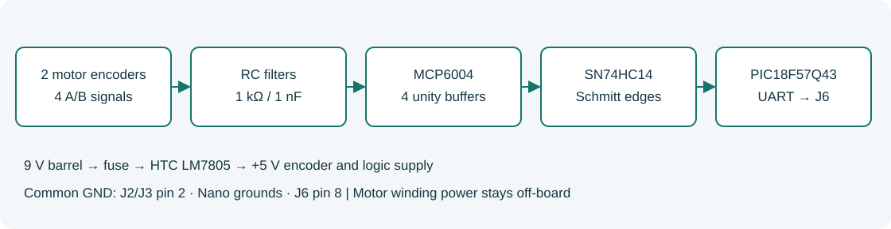

# Block Diagram

Revision D monitors the two teacher-supplied motors through their integrated Hall encoders. Each motor contributes A/B quadrature signals.

1. The motor driver supplies the red/black 12 V winding leads independently.
2. This board supplies +5 V and common ground to the blue/green encoder leads through J2/J3.
3. Four yellow/white A/B signals pass through pull-ups, 1 kΩ / 1 nF RC filters, MCP6004 buffers and HC14 Schmitt inverters.
4. RB0–RB3 receive the conditioned signals. Firmware counts transitions and determines direction.
5. RC6/RC7 connect to the team UART through J6: pin 1 TX, pin 2 RX, pin 8 common ground.

A 9 V barrel input, fuse and HTC LM7805 produce the local 5 V rail. The Nano uses VTG with VOFF grounded for external-powered USB operation. See the [schematic](../04-Schematic/schematic.md) for pin-level details and [PCB Design](../06-PCB-Design/PCB-Design.md) for fabrication files.
