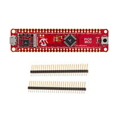
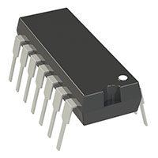
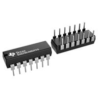

# Component Selection

The teacher-approved motor change removes four TCST2103 optical interrupters and their emitter resistors. The website's visual theme is retained; the current circuit is **Revision D**.

OFF-BOARD · 2 MOTORS

### E-S Motor 25SG-370CA-78-EN
12 V gear motor, 108 rpm, integrated two-channel magnetic encoder. The encoder receives 5 V from this board. Red/black motor wires go to the motor driver.

[Teacher's exact motor listing](https://www.robotshop.com/products/e-s-motor-25dx54l-12v-gear-motor-with-magnetic-encoder-108-rpm) · [Encoder wiring document](https://cdn.robotshop.com/rbm/a00a7635-653b-4220-aac9-b0c23c5c5e2c/7/7ef8b36b-a206-40b0-a32b-885875d30965/ba82ad34_25SG-370CA-encoder.pdf)

A1 · 1 MODULE

### PIC18F57Q43 Curiosity Nano
Existing DM164150 module; two 1×28 sockets, 2.54 mm pitch, 15.24 mm row spacing. External regulated 5 V enters VTG; VOFF is grounded.

U2 · DIP-14

### MCP6004-I/P
Four rail-to-rail unity buffers preserve the encoder logic swing after the RC filters. All four amplifiers are used.

[Manufacturer datasheet](https://ww1.microchip.com/downloads/en/DeviceDoc/MCP6001-1R-1U-2-4-1-MHz-Low-Power-Op-Amp-DS20001733L.pdf)

U3 · DIP-14

### SN74HC14N
Four Schmitt inverter channels, with two unused inputs pulled low individually through 10 kΩ. Both phases are inverted.

[TI datasheet](https://www.ti.com/lit/ds/symlink/sn74hc14.pdf)

## Power and connectors

U1 is the class **HTC LM7805**, marking 317, selected as TO-220 with 1 IN / 2 GND / 3 OUT. J1 selects the PJ-102AH center-positive 2.1 mm barrel-jack footprint; verify the actual adapter and class part. F1 selects 5×20 mm cartridge clips and a provisional 500 mA fast fuse, subject to measured current and kit compatibility. J2/J3 are four-way 5.08 mm screw terminals, and J6 is a keyed 2×4 2.54 mm IDC header. Do not substitute parts by appearance without checking pin assignments and dimensions.

## PIC signal plan

| Function | Planned PIC pins | Requirement |
| --- | --- | --- |
| Motor 1 A/B | RB0 / RB1 | Digital encoder inputs |
| Motor 2 A/B | RB2 / RB3 | Digital encoder inputs |
| UART TX / RX | RC6 / RC7 | PPS and 5 V receiver compatibility |
| Debug LED / button | RA3 / RA4 | Firmware direction and debounce |
| Auxiliary header | RA0 / RA1 | Available for debug |

Firmware and counts-per-revolution calibration remain pending. The supplier attachment and listing give conflicting pulse counts. See the [schematic](../04-Schematic/schematic.md), [PCB page](../06-PCB-Design/PCB-Design.md) and [current BOM](../03-BOM/BOM.md).
