# Bill of Materials

The purchasing examples below translate the **Revision B encoder schematic** into a priced parts list for one two-motor encoder subsystem. They include four off-board optical sensors, and count each multi-unit IC as one physical package. Fuse/holder and jumper/shunt are listed separately so those small but necessary pieces are not missed.

1 encoder subsystemUSD · quantity-one reference pricesSources reviewed October 28, 2026

## Cost at a glance

<b>$38.95</b>Sourced parts subtotal

<b>$20.94</b>Controller + sensors + ICs

<b>$8.90</b>Resistors + capacitors

<b>$9.11</b>Connectors + protection + debug

Each line uses the supplier page's **one-piece unit price multiplied by the quantity needed**, without assuming volume discounts. These are dated reference prices, not a checkout quotation. Shipping, taxes, tariffs, custom PCBs, assembly, Nano sockets, mating cables, disk/bracket fabrication and thermal hardware are excluded. The optional adapter is listed separately below.

[Download priced BOM CSV](encoder-revb-bom.csv){.download} [Download sourcing record](encoder-parts-sources.json){.download} [Download KiCad project](../04-Schematic/Team103_Encoder_EK_Project.zip){.download}

## Core electronics

| Part / reference photo | Ref. / Qty | Manufacturer & example MPN | Unit USD | Line USD | Sources |
| --- | --- | --- | ---: | ---: | --- |
| 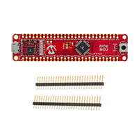 **PIC18F57Q43 Curiosity Nano** | A1 **1 pcs** | Microchip <code>DM164150</code> | $10.61 | **$10.61** | [Supplier](https://www.digikey.com/en/products/detail/microchip-technology/DM164150/11586705) · specs/docs on supplier page |
| 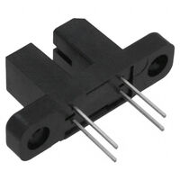 **Bare optical interrupter, 3.1 mm slot** | Q1–Q4 **4 pcs** | Vishay <code>TCST2103</code> | $1.84 | **$7.36** | [Supplier](https://www.digikey.com/en/products/detail/vishay-semiconductor-opto-division/TCST2103/2354849) · [Datasheet](https://www.vishay.com/docs/81147/tcst2103.pdf) |
| 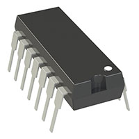 **Quad rail-to-rail op-amp, PDIP-14** | U2 **1 pcs** | Microchip <code>MCP6004-I/P</code> | $0.60 | **$0.60** | [Supplier](https://www.digikey.com/en/products/detail/MCP6004-I%2FP/MCP6004-I%2FP-ND/523060) · [Datasheet](https://ww1.microchip.com/downloads/en/DeviceDoc/MCP6001-1R-1U-2-4-1-MHz-Low-Power-Op-Amp-DS20001733L.pdf) |
|  **Hex Schmitt inverter, PDIP-14** | U3 **1 pcs** | Texas Instruments <code>SN74HC14N</code> | $1.15 | **$1.15** | [Supplier](https://www.digikey.com/en/products/detail/texas-instruments/SN74HC14N/277223) · specs/docs on supplier page |
| 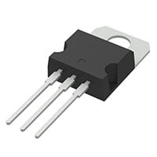 **5 V linear regulator, TO-220** | U1 **1 pcs** | STMicroelectronics <code>L7805ACV</code> | $1.22 | **$1.22** | [Supplier](https://www.digikey.com/en/products/detail/stmicroelectronics/L7805ACV/585962) · [Datasheet](https://www.st.com/content/ccc/resource/technical/document/datasheet/41/4f/b3/b0/12/d4/47/88/CD00000444.pdf/files/CD00000444.pdf/jcr%3Acontent/translations/en.CD00000444.pdf) |

## Resistors and capacitors

| Part / reference photo | Ref. / Qty | Manufacturer & example MPN | Unit USD | Line USD | Sources |
| --- | --- | --- | ---: | ---: | --- |
| 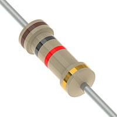 **220 Ω, 0.25 W, ±5% axial resistor** | R2, R6, R10, R14 **4 pcs** | YAGEO <code>CFR-25JB-52-220R</code> | $0.10 | **$0.40** | [Supplier](https://www.digikey.com/en/products/detail/yageo/CFR-25JB-52-220R/1295) · specs/docs on supplier page |
|  **1 kΩ, 0.25 W, ±5% axial resistor** | R1, R18 **2 pcs** | YAGEO <code>CFR-25JB-52-1K</code> | $0.10 | **$0.20** | [Supplier](https://www.digikey.com/en/products/detail/yageo/CFR-25JB-52-1K/96) · [Datasheet](https://yageogroup.com/content/datasheet/asset/file/YAGEO-CFR_DATASHEET) |
|  **4.7 kΩ, 0.25 W, ±5% axial resistor** | R3, R7, R11, R15 **4 pcs** | YAGEO <code>CFR-25JB-52-4K7</code> | $0.10 | **$0.40** | [Supplier](https://www.digikey.com/en/products/detail/yageo/CFR-25JB-52-4K7/1846) · specs/docs on supplier page |
|  **10 kΩ, 0.25 W, ±5% axial resistor** | R4, R8, R12, R16, R19 **5 pcs** | YAGEO <code>CFR-25JB-52-10K</code> | $0.10 | **$0.50** | [Supplier](https://www.digikey.com/en/products/detail/yageo/CFR-25JB-52-10K/338) · specs/docs on supplier page |
|  **20 kΩ, 0.25 W, ±5% axial resistor** | R5, R9, R13, R17 **4 pcs** | YAGEO <code>CFR-25JB-52-20K</code> | $0.10 | **$0.40** | [Supplier](https://www.digikey.com/en/products/detail/yageo/CFR-25JB-52-20K/880) · specs/docs on supplier page |
| 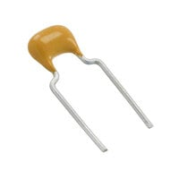 **0.33 µF, 50 V, Z5U radial capacitor** | C1 **1 pcs** | KEMET <code>C330C334M5U5TA</code> | $0.87 | **$0.87** | [Supplier](https://www.digikey.com/en/products/detail/kemet/C330C334M5U5TA/818186) · specs/docs on supplier page |
| 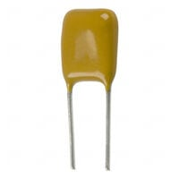 **0.1 µF / 100 nF, 50 V, Z5U radial capacitor** | C2, C8, C9, C10, C11 **5 pcs** | KEMET <code>C315C104M5U5TA</code> | $0.58 | **$2.90** | [Supplier](https://www.digikey.com/en/products/detail/kemet/C315C104M5U5TA/817927) · [Datasheet](https://yageogroup.com/content/datasheet/asset/file/KEM_C1051_GOLDMAX_Z5U) |
|  **1 nF, 50 V, ±5% C0G radial capacitor** | C4–C7 **4 pcs** | KEMET <code>C315C102J5G5TA</code> | $0.71 | **$2.84** | [Supplier](https://www.digikey.com/en/products/detail/kemet/C315C102J5G5TA/12700309) · [Datasheet](https://yageogroup.com/content/datasheet/asset/file/KEM_C1049_GOLDMAX_C0G) |
| 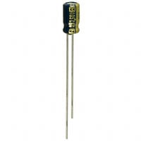 **10 µF, 25 V, radial aluminum capacitor** | C3 **1 pcs** | Panasonic <code>EEA-FC1E100</code> | $0.39 | **$0.39** | [Supplier](https://www.digikey.com/en/products/detail/panasonic-electronic-components/EEA-FC1E100/356116) · specs/docs on supplier page |

*Resistor photos are representative of the YAGEO CFR axial family; band colors vary with resistance. Supplier capacitor images can also represent a family. The printed MPN, electrical value and dimensional drawing govern selection.*

## Connectors, protection and debug

| Part / reference photo | Ref. / Qty | Manufacturer & example MPN | Unit USD | Line USD | Sources |
| --- | --- | --- | ---: | ---: | --- |
| 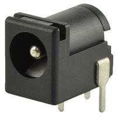 **Right-angle through-hole DC barrel jack** | J1 **1 pcs** | Same Sky <code>PJ-102A</code> | $0.75 | **$0.75** | [Supplier](https://www.digikey.com/en/products/detail/same-sky-formerly-cui-devices/PJ-102A/275425) · specs/docs on supplier page |
| 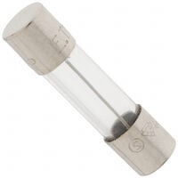 **500 mA fast-acting 5 × 20 mm cartridge fuse** | F1 fuse **1 pcs** | Littelfuse <code>0217.500MXP</code> | $0.57 | **$0.57** | [Supplier](https://www.digikey.com/en/products/detail/littelfuse-inc/0217-500MXP/777537) · [Datasheet](https://www.littelfuse.com/assetdocs/littelfuse-fuse-217-datasheet?assetguid=af55be94-c42e-41b1-ad43-e070e09443fe) |
| 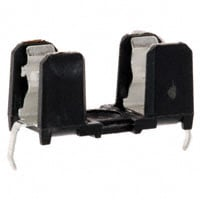 **PCB fuse holder for 5 × 20 mm cartridge** | F1 holder **1 pcs** | SCHURTER <code>0031.8201</code> | $1.36 | **$1.36** | [Supplier](https://www.digikey.com/en/products/detail/schurter-inc/0031-8201/669925) · [Datasheet](https://us.schurter.com/en/datasheet/typ_OGN.pdf) |
| 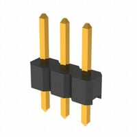 **1 × 3 male header, 2.54 mm** | J2–J5 **4 pcs** | Sullins <code>PRPC003SAAN-RC</code> | $0.10 | **$0.40** | [Supplier](https://www.digikey.com/en/products/detail/sullins-connector-solutions/PRPC003SAAN-RC/2775251) · [Datasheet](https://mm.digikey.com/Volume0/opasdata/d220001/medias/docus/386/xRxCzzzSxxN-RC_ST_11635-B.pdf) |
| 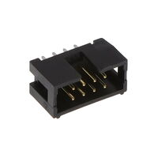 **2 × 4 shrouded male header, 2.54 mm** | J6 **1 pcs** | 3M <code>N2508-6002-RB</code> | $2.31 | **$2.31** | [Supplier](https://www.digikey.com/en/products/detail/3m/N2508-6002-RB/2609703) · specs/docs on supplier page |
|  **1 × 4 male header, 2.54 mm** | J7 **1 pcs** | Sullins <code>PRPC004SAAN-RC</code> | $0.10 | **$0.10** | [Supplier](https://www.digikey.com/en/products/detail/sullins-connector-solutions/PRPC004SAAN-RC/2775250) · specs/docs on supplier page |
| 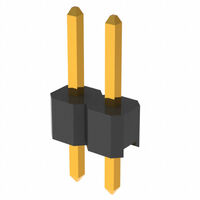 **1 × 2 male header, 2.54 mm** | JP1 header **1 pcs** | Sullins <code>PRPC002SAAN-RC</code> | $0.10 | **$0.10** | [Supplier](https://www.digikey.com/en/products/detail/sullins-connector-solutions/PRPC002SAAN-RC/2775252) · specs/docs on supplier page |
| 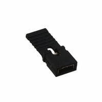 **2.54 mm removable jumper shunt** | JP1 shunt **1 pcs** | Sullins <code>NPC02SXON-RC</code> | $0.10 | **$0.10** | [Supplier](https://www.digikey.com/en/products/detail/sullins-connector-solutions/NPC02SXON-RC/2618266) · specs/docs on supplier page |
| 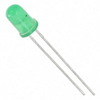 **5 mm green through-hole LED** | D1 **1 pcs** | Kingbright <code>WP7113GD</code> | $0.23 | **$0.23** | [Supplier](https://www.digikey.com/en/products/detail/kingbright/WP7113GD/1747662) · specs/docs on supplier page |
| 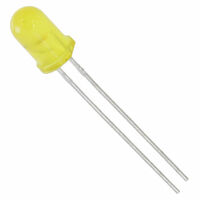 **5 mm yellow through-hole LED** | D2 **1 pcs** | Kingbright <code>WP7113YD</code> | $0.23 | **$0.23** | [Supplier](https://www.digikey.com/en/products/detail/kingbright/WP7113YD/1747683) · [Datasheet](https://www.kingbrightusa.com/images/catalog/SPEC/WP7113YD.pdf) |
| 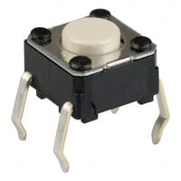 **Through-hole momentary SPST-NO tactile switch** | SW1 **1 pcs** | Omron <code>B3F-1000</code> | $0.35 | **$0.35** | [Supplier](https://www.digikey.com/en/products/detail/omron-electronics-inc-emc-div/B3F-1000/33150) · [Datasheet](https://omronfs.omron.com/en_US/ecb/products/pdf/en-b3f.pdf) |
| 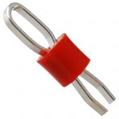 **Through-hole loop test point** | TP1–TP9 **9 pcs** | Keystone <code>5010</code> | $0.29 | **$2.61** | [Supplier](https://www.digikey.com/en/products/detail/keystone-electronics/5010/255332) · specs/docs on supplier page |

## External power example

| Part / reference photo | Ref. / Qty | Manufacturer & example MPN | Unit USD | Line USD | Sources |
| --- | --- | --- | ---: | ---: | --- |
| 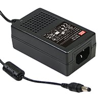 **9 V / 2 A desktop adapter** | External to board **1 pcs** | MEAN WELL <code>GST18A09-P1J</code> | $14.10 | **$14.10** | [Supplier](https://www.digikey.com/en/products/detail/mean-well-usa-inc/GST18A09-P1J/7703606) · [Datasheet](https://www.meanwellusa.com/upload/pdf/GST18A/GST18A-spec.pdf) |

Adding this adapter gives an illustrative **$53.05 parts-plus-adapter subtotal**, before the exclusions above. Its AC input cord is sold separately. Check its 5.5 × 2.1 mm center-positive plug against the chosen jack and confirm the mains cord needed locally. This adapter's 2 A rating is available capacity; it does not mean the encoder consumes 2 A or resolves regulator heating.

## Fit, sourcing and assembly notes

- **A1 / DM164150:** Board already specified; include replacement cost even if course-provided.
- **Q1–Q4 / TCST2103:** Off-board A/B sensors; fit to the disk and bracket still required.
- **U2 / MCP6004-I/P:** Orderable through-hole example for the MCP6004 drawn in Revision B.
- **U3 / SN74HC14N:** Four gates used; two unused inputs held at a defined level.
- **U1 / L7805ACV:** Thermal design and heatsink remain to be verified.
- **R5, R9, R13, R17 / CFR-25JB-52-20K:** DigiKey page lists backorder; compare Mouser availability before ordering.
- **C1 / C330C334M5U5TA:** 50 V example exceeds the schematic’s 25 V rating; check 5.08 mm lead spacing.
- **C2, C8, C9, C10, C11 / C315C104M5U5TA:** Example value/rating match; X7R may be preferable where stability matters.
- **C4–C7 / C315C102J5G5TA:** C0G dielectric supports a more stable filter capacitance.
- **C3 / EEA-FC1E100:** Polarized example: verify + terminal and footprint lead spacing.
- **J1 / PJ-102A:** Example only: confirm plug fit, polarity and physical pad numbering.
- **F1 fuse / 0217.500MXP:** Separate removable fuse and holder; validate protection and DC application.
- **F1 holder / 0031.8201:** Physical holder example; footprint must match its drawing.
- **J2–J5 / PRPC003SAAN-RC:** Board-side sensor headers only; mating housings/cables excluded.
- **J6 / N2508-6002-RB:** Example sold individually; final ribbon connector and pinout require team agreement.
- **J7 / PRPC004SAAN-RC:** Spare GPIO / +5 V / GND.
- **JP1 shunt / NPC02SXON-RC:** Separate shunt needed to close TX isolation jumper.
- **SW1 / B3F-1000:** Four physical legs, two electrical contacts; verify paired pins in the footprint.
- **TP1–TP9 / 5010:** One red example for pricing; distinguish GND by marking or a black variant.

## Items still requiring a quote or team decision

| Item | Quantity / scope | Why it is outside the priced subtotal |
| --- | --- | --- |
| Nano carrier sockets | Two 1 × 28 receptacles; example Sullins PPPC281LFBN-RC | Confirm stack height, footprint and current small-quantity quote. |
| Sensor cables and mates | Four three-conductor assemblies | Length, strain relief, connector polarization and motor placement remain open. |
| Ribbon cable and IDC mate | Team cable assembly | Final connector orientation, length and signal allocation are deferred. |
| Encoder disks and brackets | Two disks / four sensor mounts | Shaft diameter, slots and clearances depend on the selected motors. |
| Regulator heatsink / hardware | As required by thermal measurements | TO-220 fit, airflow and temperature rise must be checked. |
| Custom encoder PCB and mounting hardware | One board | Layout is not yet complete; obtain fabrication/assembly pricing later. |
| Motors | Two, on the driver subsystem | Team-selected actuation hardware; excluded from this individual encoder BOM. |

## Photo credits and selection status

Reference product images are supplied by the linked manufacturers through DigiKey; attribution and original image URLs are retained in the sourcing record. Images are hosted locally for reliable display. Photographs show purchasing examples, not parts already owned or assembled. New support-component MPNs are **fit-check candidates**; they do not imply assigned or verified PCB footprints.

**Revision B consistency:** C11 is 100 nF in the exported netlist. With R19 = 10 kΩ, the nominal time constant is 1 ms. Resolve the older 10 ms annotation before fabrication. No schematic electrical values were changed during this website refinement.
