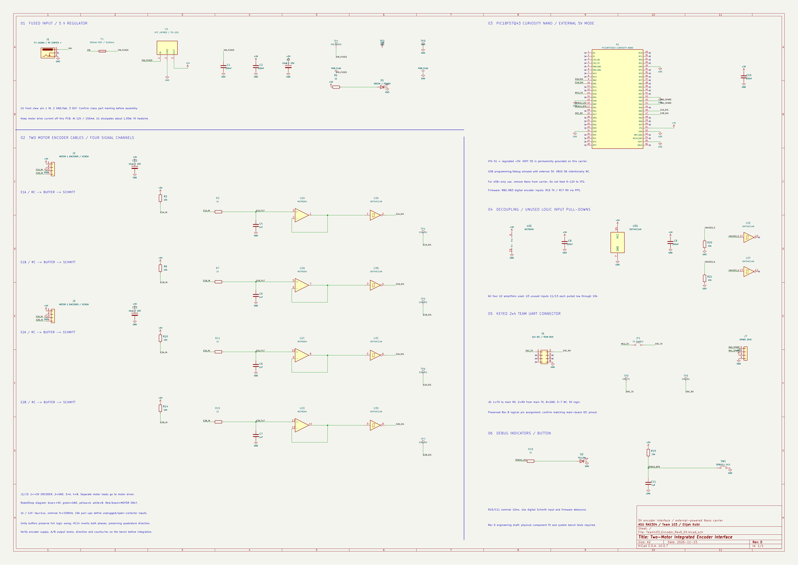

# Schematic Design

Revision D replaces the four optical interrupters with the two teacher-supplied **E-S Motor 25SG-370CA-78-EN integrated magnetic encoders**. The four A/B signals still pass through RC filters, MCP6004 op-amp buffers, SN74HC14 Schmitt inverters and the PIC18F57Q43 Curiosity Nano.

*Figure 2. Revision D · Elijah Koiki · Team 103 · KiCad 10.0.7 · November 15, 2026.*

[High-resolution schematic PDF](Team103_Encoder_RevD_Schematic.pdf){.download} [ERC report](erc.rpt){.download}

## Protected local power

J1 is a **9 V center-positive barrel input**, using the selected CUI PJ-102AH footprint. Its center pin feeds F1 and the HTC LM7805; sleeve is common ground and the switched contact is unused. The regulator marking supplied by the student is **HTC LM7805 317**. Pins are 1 IN, 2 GND/tab, 3 OUT, drawn together on one side. Actual jack, fuse clips and regulator fit must be checked with the 1:1 print. Input, output and local bypass capacitors support the 5 V rail; D1 indicates power.

Nano **VTG edge 51 = +5 V**, **VOFF edge 55 = GND**, **VBUS edge 56 = NC**. This disables the Nano regulator for external-powered USB programming/debugging. VOFF is permanently grounded on this carrier; remove the Nano from the carrier for USB-only operation. Never apply the 9 V input to VTG. See [Microchip's hardware guide](https://ww1.microchip.com/downloads/aemDocuments/documents/MCU08/ProductDocuments/UserGuides/PIC18F57Q43-Curiosity-Nano-HW-UserGuide-DS40002186B.pdf).

## Encoder harnesses

Each motor uses one four-position screw terminal, J2 or J3. The [encoder attachment](https://cdn.robotshop.com/rbm/a00a7635-653b-4220-aac9-b0c23c5c5e2c/7/7ef8b36b-a206-40b0-a32b-885875d30965/ba82ad34_25SG-370CA-encoder.pdf) on the [teacher's motor listing](https://www.robotshop.com/products/e-s-motor-25dx54l-12v-gear-motor-with-magnetic-encoder-108-rpm) identifies the following functions. Confirm them against the actual harness and sensor PCB before power-up.

| Board pin | Function | Motor wire |
| --- | --- | --- |
| J2/J3 1 | Encoder +5 V | Blue |
| J2/J3 2 | Common ground | Green |
| J2/J3 3 | Encoder A | Yellow |
| J2/J3 4 | Encoder B | White |
| Off-board | Motor winding + / −, to motor driver | Red / black |

The encoder attachment specifies 3.5–20 V supply, up to 10 mA, and approximately 0-to-Vcc A/B outputs. **12 V applies to the motor windings; this PCB supplies the encoder at 5 V.** Its 64 counts/motor-revolution description conflicts with the listing's 11 PPR. Firmware counts per output revolution must be calibrated rather than hardcoded from either conflicting description.

## Filtering and digital conditioning

Each input has a 10 kΩ pull-up and a 1 kΩ / 1 nF RC filter: nominal τ = 1 µs and pole ≈159 kHz. The four MCP6004 stages are unity buffers, avoiding the previous gain-1.5 stage's saturation on full-swing logic pulses. HC14 hysteresis cleans the edges and inverts both A/B phases. Direction still depends on harness phase ordering and the firmware convention.

All four op-amps are used. Unused HC14 inputs 11 and 13 each have a 10 kΩ pull-down; unused outputs 10 and 12 are NC. Supply bypass capacitors are provided. The general course analog-gain requirement needs instructor confirmation for this teacher-approved integrated-encoder change; unity buffers are explicitly identified here.

## Main-board interface

J6 is a keyed **2×4 IDC ribbon connector**. The user confirmed this mapping: **1 = encoder TX, 2 = encoder RX, 8 = common ground**, 3–7 unused. Pin 8 is electrically the same GND net as both encoder grounds, the power supply and Nano. RC6/RC7 use the planned 5 V UART interface and require firmware PPS configuration. JP1 can isolate TX. Main-board logic-level compatibility must be verified before connection.

## Verification and PCB files

ERC and DRC evidence, editable project, Gerbers, layout views and fabrication status are on the new [PCB Design page](../06-PCB-Design/PCB-Design.md). Revision D is an engineering review design. Electrical bench tests and component fit checks remain pending. KiCad checks do not prove a working physical board. No order has been placed.
