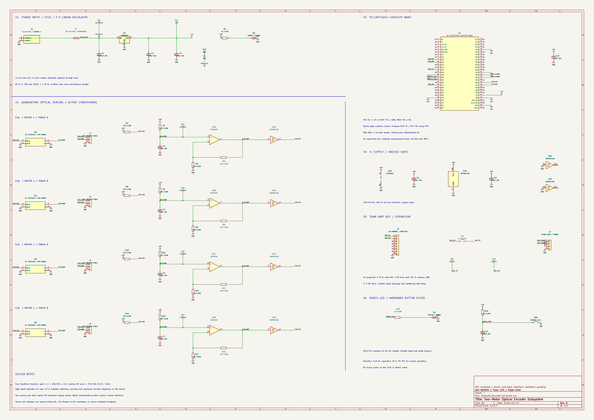

# Schematic Design

Revision B implements four optical channels for two motors, local 5 V regulation, a PIC18F57Q43 Nano, debug I/O and the proposed serial interface to the main board. The full schematic is embedded below; select the image to zoom, or open the PDF to inspect small labels.

*Figure 2. Revision B, reviewed October 27, 2026 in KiCad 10.0.7.*

[High-resolution schematic PDF](Team103_Encoder_EK.pdf){.download} [Complete KiCad project ZIP](Team103_Encoder_EK_Project.zip){.download} [ERC report JSON](erc_after.json){.download} [Engineering review notes](REVIEW_AND_TESTS.txt){.download}

## How the circuit works

### 1. Protected local power

J1 takes a center-positive 9–12 V source. F1 feeds VIN_FUSED, and the L7805ACV generates +5 V. Input/output capacitors and local decoupling support the regulator and ICs; the green power LED indicates that the rail is present. Test points expose VIN_FUSED, +5 V and ground. Regulator thermal performance must be verified using the [power budget](../05-Power-Budget/Power-Budget.md).

The Nano is represented as a passive connector: +5 V enters VTG edge 51 and VOFF edge 55 is grounded, following the external-power approach documented in the Nano user guide. VBUS edge 56 is not connected in this design. Check board orientation and the guide before connecting external power and USB.

### 2. Optical current to analog voltage

Four off-board TCST2103 sensors monitor the two disks. Each emitter uses a 220 Ω series resistor, giving approximately `(5 − 1.25) / 220 = 17 mA` under the stated nominal forward-drop assumption. The phototransistor collector works with a 4.7 kΩ pull-up and a 1 nF capacitor. TP4–TP7 expose the raw channels for blocked/unblocked testing.

### 3. Amplification and digital edges

U2 is a quad MCP6004. Each non-inverting stage has nominal gain 1.5; a high raw signal can drive its output into positive saturation. That behavior makes saturation recovery, rail levels and pulse width key bench tests. The SN74HC14 then applies Schmitt hysteresis and inversion before RB0–RB3 receive the signals. The filter's nominal 33.9 kHz pole is a calculation, not a demonstrated operating-rate limit.

### 4. Counting and reporting

The PIC's proposed firmware tracks transitions in each A/B pair and reports counts and timing to the main board. RC6 TX passes through JP1 to J6; removing JP1 isolates the transmit path. RC7 receives ENC_RX. The proposed connection is **5 V logic UART**, not RS-232 voltage levels. Shared multidriver operation has not been approved; the team must resolve addressing/topology and avoid output contention.

### 5. Debug and serviceability

RA3 drives the yellow debug LED. RA4 reads SW1 with R19 and C11; firmware debounce remains necessary. RA0/RA1 are available at J7. Labeled connectors, channel test points and the TX jumper support independent bring-up of the power, sensing and communication stages.

## Verification evidence

| Check | Recorded result | Scope |
| --- | --- | --- |
| Original schematic ERC | 2 errors, 125 warnings | Baseline from the local review records |
| Revision B CLI and GUI ERC | **0 errors, 0 warnings** | KiCad 10.0.7, October 27, 2026 |
| Netlist comparison | Connected PCB component pin sets unchanged | Original and Revision B electrical connectivity comparison |
| Hardware sensing, firmware and physical fit | **Pending** | No working prototype or measurement record supplied |
| Encoder PCB layout / DRC | **Pending** | The encoder project contains a schematic, not a validated PCB layout |

The ERC report retains four default ignored categories: single global label, four-way junction, simulation model issue and footprint filter. No individual violations were excluded to obtain the reported pass. ERC checks schematic rules; it does not validate the optical or analog performance, Nano firmware directions, footprint fit or safe operating temperature.

## Open items before fabrication

Confirm optical mounting and the maximum pulse rate; measure amplifier recovery and clean HC14 output levels; resolve the **C11 100 nF / 1 ms versus 10 ms annotation mismatch**; select and verify missing footprints; check external power and thermal behavior; and agree the final ribbon mapping with the team. The detailed [review checklist](../Appendix/index.md) provides the bring-up sequence.
