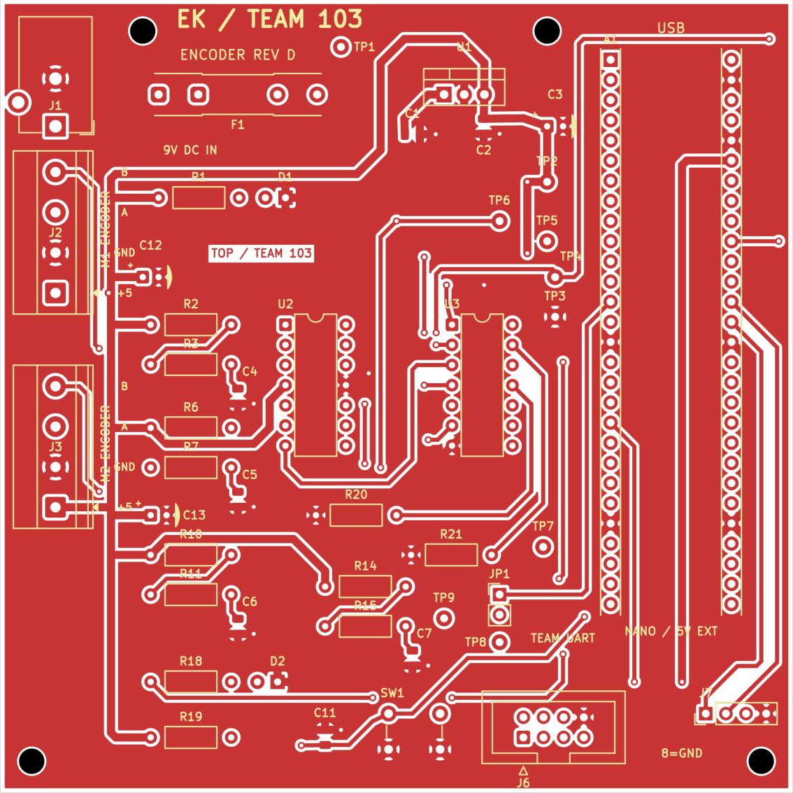
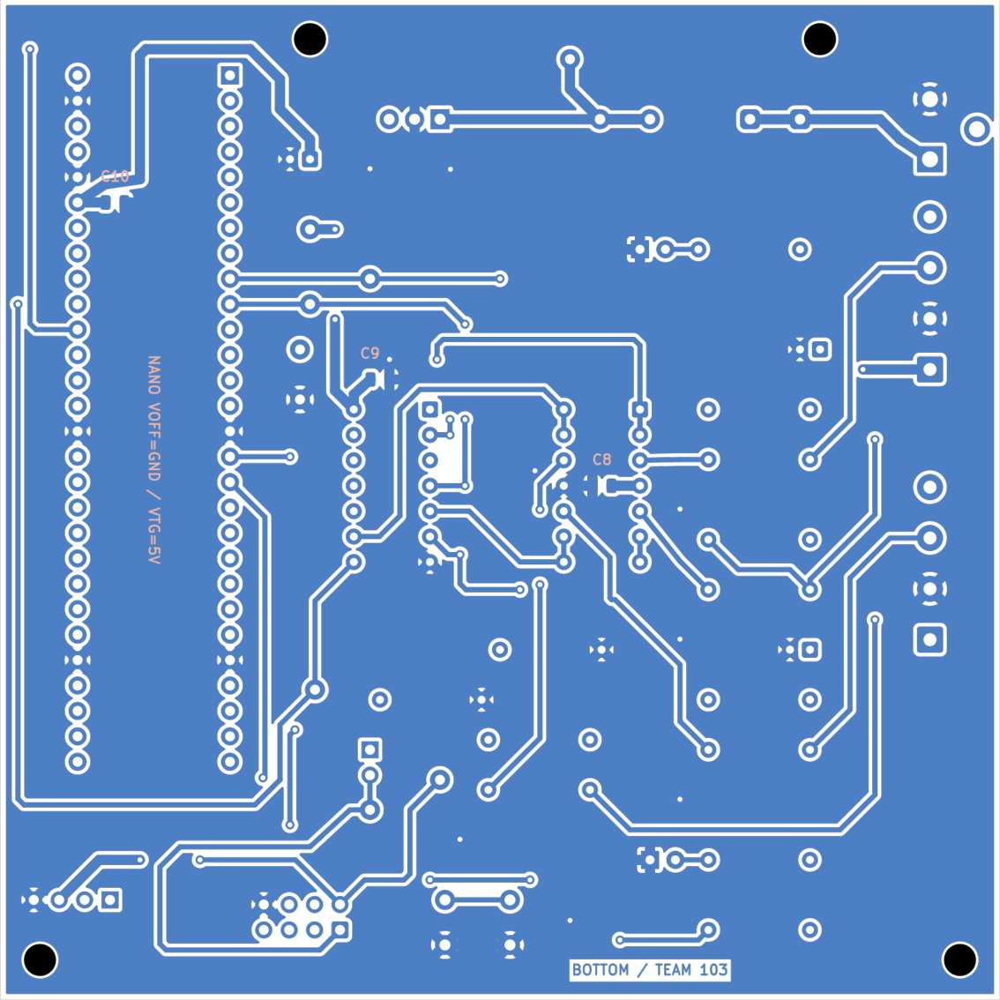
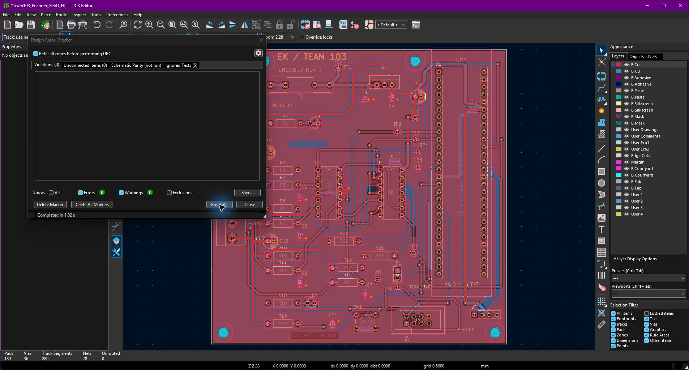
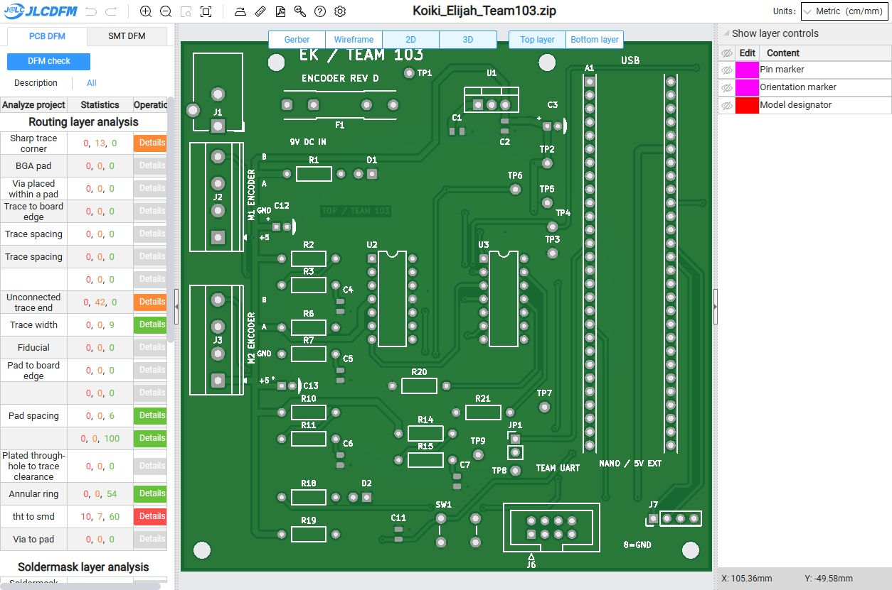

# PCB Design

The two-layer **100 × 100 mm Revision D** routes both motor encoders, power regulation, conditioning, debug features and the Nano carrier. Motor winding current stays on the motor-driver board. The original Revision B and earlier PCB review are preserved locally.

<b>2</b>Copper layers

<b>100 mm</b>Square outline

<b>0.5 mm</b>Via drill

<b>2×4</b>Keyed team ribbon

## Layout

Signal tracks are at least 0.508 mm (20 mil), power/GND tracks 1.016 mm (40 mil), and clearance is 0.381 mm (15 mil). Through-vias are 0.9 mm diameter with 0.5 mm holes. Ground pours on both sides connect the encoder and main-board grounds. C8, C9 and C10 are on the back. Four 3.2 mm mounting holes and a Nano USB access area support assembly.

## Download package

[Gerber ZIP — Koiki_Elijah_Team103.zip](Koiki_Elijah_Team103.zip){.download} [Editable KiCad project and review package](Team103_Encoder_RevD_Review_Package.zip){.download} [Front/back PDF](Team103_Encoder_RevD_PCB_Front_Back.pdf){.download} [1:1 component fit print](Team103_Encoder_RevD_1to1_Fit_Check.pdf){.download} [Board BOM CSV](BOM_RevD.csv){.download} [DRC machine report](drc.json){.download}

## Submission evidence

The required Gerber ZIP, real KiCad zero-error DRC screenshot and real JLCDFM preview/analysis screenshot are prepared. Add the schematic page URL and this page URL as Canvas comments. Nothing has been submitted to Canvas or ordered.

[Supplementary silkscreen/drill screenshot](Koiki_Elijah_DFM_Silk_Drill.png){.download} [Full DFM findings and review notes](JLCDFM_REVIEW.md) [Raw result record](jlcdfm-results.json){.download}

**DFM analysis completed, with findings retained.** Silkscreen clearances were corrected and now report zero issues. Default-rule assembly-separation, sharp-corner, track-end and NPTH-import findings remain visible; see the review notes. No custom thresholds were relaxed. This evidence is not an unconditional fabrication approval.

[Engineering review checklist](README_REVIEW_FIRST.md)

## Fabrication and release review

The CAD stackup records 1.6 mm FR4 and 0.5 oz copper per side. The course mill-spec document states 0.059 inch thickness and the assignment requests 0.5 oz; JLCPCB commonly supplies 1.6 mm / 1 oz outer copper. Confirm the instructor's batch-order settings before release. The design's conservative copper widths do not themselves change the manufacturer's selected stackup. Drill output uses Excellon inch units.

Before approval: fit the actual class jack, fuse clips, TO-220 regulator, Nano sockets and connectors to the print; review regulator temperature; confirm the analog rubric exception and stackup; verify 5 V logic compatibility; and review the remaining DFM findings. Parts and delivered fabrication costs require a current quote and class-stock inventory. The course budget is $60 per team member with the stated class-supplied exclusions. No budget pass is claimed from the obsolete optical-sensor BOM.

Revision D is an engineering review design. Electrical bench tests and component fit checks remain pending. KiCad checks do not prove a working physical board. No order has been placed. Ordering requires the student's explicit approval after review; this website does not authorize purchasing.
