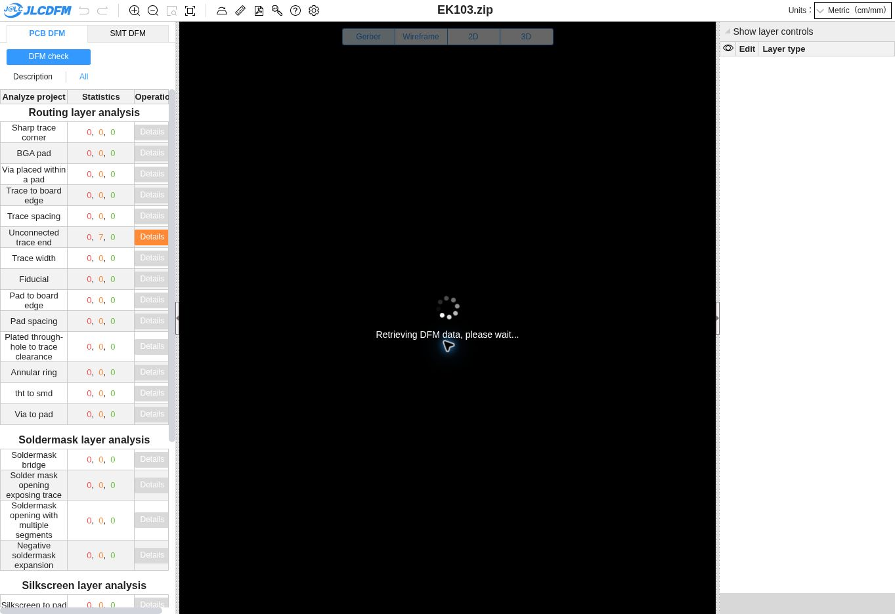

# Review & Resources

## External review walkthrough

For the October 29, 2026 design review, use the [overview](../index.md) to introduce the subsystem, the [block diagram](../01-Block-Diagram/Block-Diagram.md) and [component selection](../02-Component-Selection/Component-Selection.md) to explain the architecture, then the [schematic](../04-Schematic/schematic.md) to follow one channel and its power/debug circuits. The [power budget](../05-Power-Budget/Power-Budget.md) supports the thermal discussion.

## Readiness and next decisions

| Item | Status | Next action |
| --- | --- | --- |
| Individual page content and navigable assignment sections | Updated for the encoder subsystem | Keep content synchronized as design decisions change. |
| Block diagram | Updated to include amplification/filtering | Review after final mechanical and interface decisions. |
| Schematic downloads and visible raster image | Revision B provided | Correct C11 annotation mismatch before fabrication. |
| Schematic ERC evidence | Recorded pass | Re-run after any electrical change. |
| Component comparisons | Current selections and tradeoffs documented | Complete commercial alternatives, exact unit costs and photos. |
| Power budget | Preliminary calculation with 25% margin | Verify load currents, adapter rating, regulator ground current and thermal limits. |
| MCC configuration | Pin/peripheral plan documented | Implement and capture the actual MCC configuration. |
| Motors and disks | Pending, intentionally deferred | Confirm shaft dimensions, speed, gearing, slot count and bracket design. |
| Ribbon interface | Proposed only, intentionally deferred | Agree pin mapping and protocol with Connor and the team. |
| Encoder PCB and bench measurements | Pending | Complete layout, physical fit checks and bring-up. |
| Team-site cross-link | Team report linked from this site | Ask the team to link Elijah's individual URL from its landing page. |

The [team PRD](https://ras304-f26-103.github.io/04-Product-Requirements/) still reflects an earlier subsystem allocation and bus mapping. This individual site follows Elijah's revised encoder role and the two-motor decision. A team-level reconciliation remains necessary; this update does not change the team repository.

## Bench verification sequence

1. Inspect connector orientation and continuity with power disconnected. Confirm fuse, regulator pins and the Nano external-power wiring.
2. Power the disconnected logic board from a current-limited supply; measure VIN_FUSED and +5 V, then check full-load temperature with the complete assembly.
3. Block and unblock each optical sensor. Probe TP4–TP7, U2 outputs and HC14 outputs for voltage levels, noise and saturation recovery.
4. Rotate each disk in both directions. Check A/B phase order, known counts per revolution and the highest required edge rate.
5. Implement firmware counting, a home/reference procedure and stable-state button debounce; verify interrupt loading and count snapshot integrity.
6. Agree the final serial link and connect one board at a time. Test TX isolation, framing, stale-data behavior and power-off conditions.

## Previous sensor-design assignment

The earlier **EK_Sensor103** KiCad/PCB exercise is retained here as a separate assignment artifact. Its DFM result does not certify the current two-motor encoder schematic or an encoder PCB.

The prior conversation recorded **0 danger findings and 7 warnings**. The warning locations were not fully confirmed; an assumption that they came from EK copper lettering remains unverified.

[Sensor assignment project ZIP](EK_Sensor103_Project.zip){.download} [Recorded DFM PDF](EK103_JLCDFM_Results.pdf){.download} [Sensor schematic / PCB PDF](EK103_Schematic_PCB.pdf){.download}

## Primary references

- [Microchip PIC18F57Q43 Curiosity Nano hardware user guide](https://ww1.microchip.com/downloads/aemDocuments/documents/MCU08/ProductDocuments/UserGuides/PIC18F57Q43-Curiosity-Nano-HW-UserGuide-DS40002186B.pdf) — board pinout and external power.
- [Vishay TCST2103 family datasheet](https://www.vishay.com/docs/81147/tcst2103.pdf) — sensor package, optical/electrical characteristics and lead markings.
- [Microchip MCP6004](https://www.microchip.com/en-us/product/MCP6004) — quad amplifier documentation.
- [Texas Instruments SN74HC14](https://www.ti.com/product/SN74HC14) — Schmitt inverter electrical specifications.
- [ST L78 family](https://www.st.com/en/power-management/l78.html) — regulator pinout, operating limits and thermal specifications.
- [Team 103 report](https://ras304-f26-103.github.io/) — shared project context; older role/interface assignments need team reconciliation.

## Design record

October 27: local KiCad review rebuilt the schematic grid, corrected ERC findings and exported Revision B. October 28: individual datasheet replaced the template examples, embedded the reviewed circuit, updated the block diagram to include conditioning, documented component rationale and added a preliminary power model. Source symbol geometry includes custom and adapted library work; EK labels alone do not establish personal authorship.
