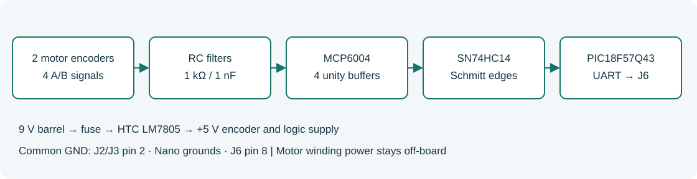

RAS304 · Fall 2026 · Team 103

# Giving ordinary motors a sense of position.

Elijah Koiki's motor encoder subsystem for the **2 DOF Smart Robot Arm Joint Showcase**. Four magnetic encoder channels turn the motion of two DC motor shafts into position and direction feedback for a distributed embedded control system.

<a class="button" href="04-Schematic/schematic/">Explore the schematic →</a>
<a class="button secondary" href="01-Block-Diagram/Block-Diagram/">Follow the signal path</a>

Elijah KoikiTeam 103Arizona State UniversityUpdated November 15, 2026

## Project summary

Team 103 is developing a modular, computer-connected control system for a two-degree-of-freedom robotic arm. Custom PCBs add sensing, communication and motor control to basic DC motors rated no higher than 12 V. My board measures both shafts using the teacher-supplied integrated magnetic quadrature encoders, conditions their signals, and uses a PIC18F57Q43 Curiosity Nano to prepare feedback for the main controller. This feedback is intended to support the team's closed-loop motion control and telemetry. See the [Team 103 report](https://ras304-f26-103.github.io/) for the wider system.

<b>2</b>Motor shafts monitored

<b>4</b>Encoder A/B channels

<b>5 V</b>Local logic supply

<b>Rev D</b>Routed review design

## My contribution

I am responsible for the **motor encoder subsystem**: shaft sensing, RC filtering and op-amp buffering, digital edge conditioning, local power regulation, and the encoder PIC's connection to the main board. Connor's main board receives the proposed feedback link; Walker's motor driver board controls motor power. Encoder firmware and physical integration are the next implementation steps.

## Explore the design

01 / ARCHITECTURE

### [Block diagram](01-Block-Diagram/Block-Diagram.md)
Trace motion through magnetic sensing, conditioning, the PIC and the proposed team connection.

02 / DESIGN CHOICES

### [Component selection](02-Component-Selection/Component-Selection.md)
Compare sensing and circuit options, then review the PIC pin and peripheral plan.

03 / MATERIALS

### [Bill of materials](03-BOM/BOM.md)
Review the parts extracted from the current Revision D schematic, including encoder harnesses.

04 / CIRCUIT DESIGN

### [Schematic](04-Schematic/schematic.md)
Inspect the embedded schematic and download its high-resolution PDF; editable files are on the PCB page.

05 / POWER

### [Power budget](05-Power-Budget/Power-Budget.md)
Review a transparent planning estimate, the 25% margin, and the regulator's thermal limits.

06 / PCB LAYOUT

### [PCB Design](06-PCB-Design/PCB-Design.md)
Review the routed board, Gerbers, KiCad package and submission requirements.

07 / DESIGN REVIEW

### [Review & resources](Appendix/index.md)
Find verification evidence, outstanding decisions, primary references and the review walkthrough.

**Current maturity:** Revision D is an engineering review design. Electrical bench tests and component fit checks remain pending. KiCad checks do not prove a working physical board. No order has been placed. The new [PCB Design page](06-PCB-Design/PCB-Design.md) holds the current fabrication and review files.

